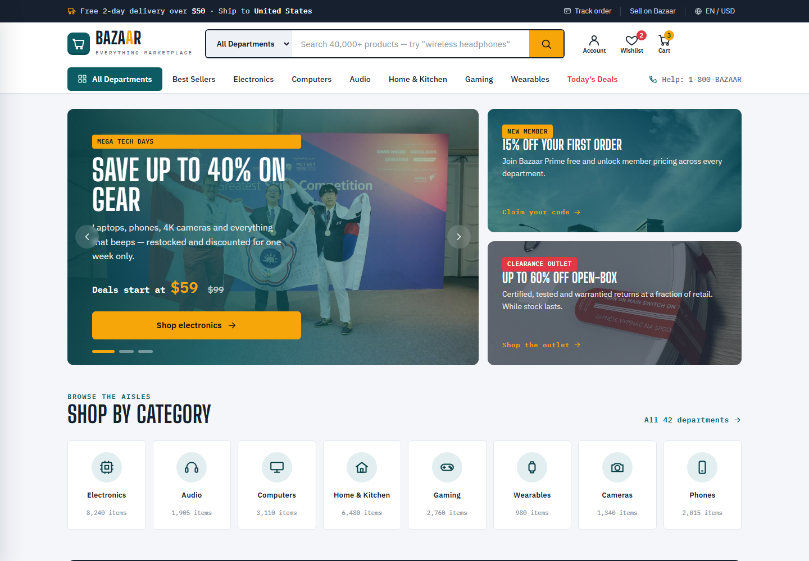
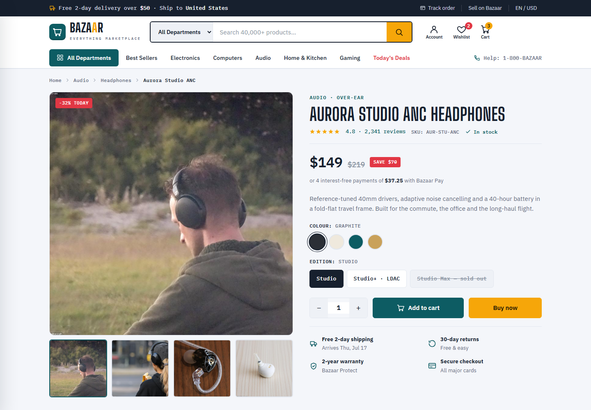
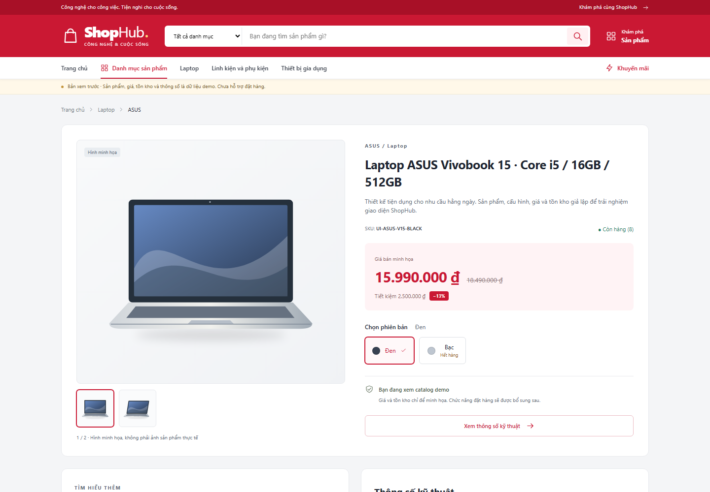
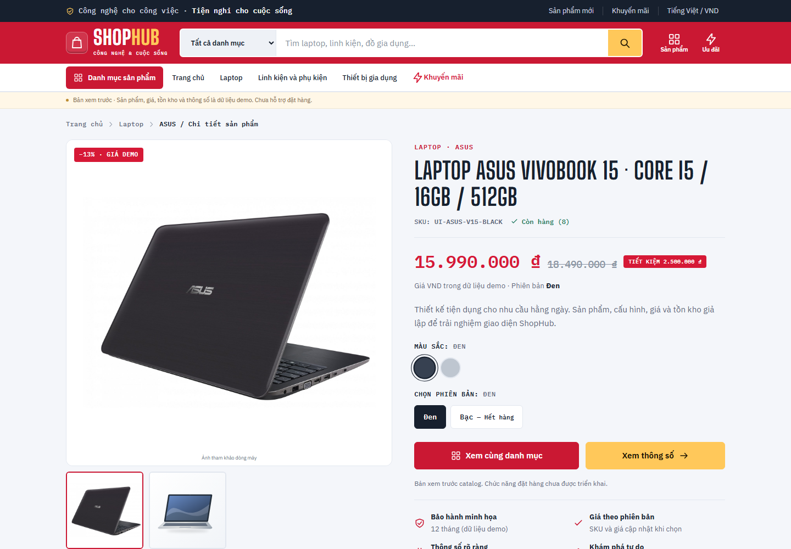
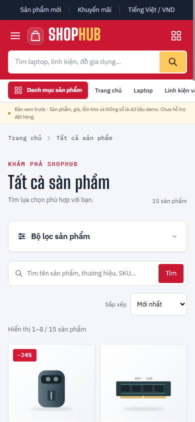
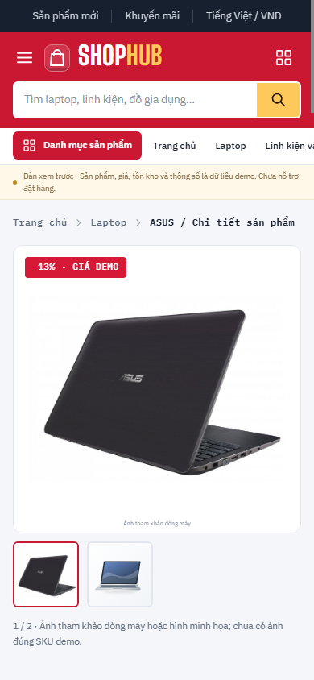

# Đối chiếu Bazaar và ShopHub

Chụp bằng Chrome headless. Desktop dùng cùng viewport **1440 × 1000**, DPR 1.
Ảnh `-top.png` là viewport; ảnh `-full.png` là toàn nội dung trang, rộng 1425px
do không gồm thanh cuộn 15px. Mobile dùng **390 × 844**, DPR 1.

Ảnh Bazaar gốc được mở trực tiếp từ HTML/CSS/JS trong thư mục tham khảo,
không sửa markup, CSS hoặc thay ảnh gốc. Các file Bootstrap vendor còn thiếu;
ảnh chụp thể hiện đúng bản nguồn được cung cấp. Google Fonts của trang gốc đã
tải được. Đã cuộn qua toàn trang để kích hoạt các khối reveal trước khi chụp.

Ảnh **trước** được chụp từ build của working tree trước khi thay giao diện;
không lấy từ Git HEAD vì còn thay đổi chưa commit. Ảnh **sau** từ build mới.
Trang chi tiết chính dùng cùng slug ASUS Vivobook 15, biến thể Đen và hình đầu.

## Trang chủ — cùng viewport desktop

| Bazaar gốc | ShopHub trước sửa | ShopHub sau sửa |
|---|---|---|
|  |  |  |
| [Toàn trang](bazaar-home-1440-full.png) | [Toàn trang](shophub-before-home-1440-full.png) | [Toàn trang](shophub-after-home-1440-full.png) |

## Chi tiết — cùng viewport desktop

| Bazaar gốc | ShopHub trước sửa | ShopHub sau sửa |
|---|---|---|
|  |  |  |
| [Toàn trang](bazaar-detail-1440-full.png) | [Toàn trang](shophub-before-detail-1440-full.png) | [Toàn trang](shophub-after-detail-1440-full.png) |

Khác sản phẩm/nội dung so với Bazaar; so sánh cấu trúc gallery, tỷ lệ hai cột,
typography, SKU/giá, swatches, lựa chọn phiên bản, bảo hành, tabs và footer.

- [Tabs thông số sau sửa](shophub-after-detail-specs-1440-top.png).
- [Biến thể Bạc hết hàng, thumbnail thứ hai](shophub-after-detail-variant-1440-top.png).
- [Danh sách trước](shophub-before-products-1440-top.png), [sau](shophub-after-products-1440-top.png).

## ShopHub sau sửa — 390px

| Trang chủ | Danh sách | Chi tiết |
|---|---|---|
|  |  |  |
| [Toàn trang](shophub-after-home-390-full.png) | [Toàn trang](shophub-after-products-390-full.png) | [Toàn trang](shophub-after-detail-390-full.png) |

[Kết quả chức năng tự động](browser-results.json).

Chạy lại build rồi `node scripts/storefront-review.mjs` trong `frontend/` để cập
nhật ảnh sau và kiểm tra. Cần Chrome tại đường dẫn Windows trong script. Script
tự mở/đóng Vite preview và Chrome; profile trình duyệt nằm trong cache bị ignore.
`--before` bị chặn nếu baseline đã có, tránh ghi đè ảnh trước bằng giao diện mới.
