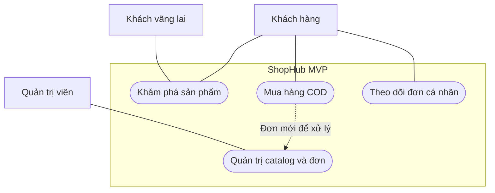

# ShopHub — Use Case System

Phiên bản thiết kế MVP · 13/11/2026

ShopHub là cửa hàng bán lẻ điện máy, công nghệ và gia dụng. Mã UC01–UC32 và T00–T13 đồng bộ với tài liệu kiến trúc nghiệp vụ.

## 1. Tác nhân

| Tác nhân | Mục tiêu và quyền |
|---|---|
| Khách vãng lai | Xem catalog, tìm sản phẩm, đọc chính sách, đăng ký và đăng nhập. |
| Khách hàng (`customer`) | Dùng địa chỉ và giỏ của mình, đặt COD, theo dõi và hủy đơn theo trạng thái. |
| Quản trị viên (`admin`) | Quản lý catalog, tồn, đơn, banner và xem dashboard. |
| Cổng thanh toán | Tác nhân tích hợp dự kiến cho UC31 sau MVP. |

V1 chỉ lưu hai role. Các đầu mối Backend, Frontend và QA là vai trò thực hiện task. Quyền sở hữu được kiểm tra ở Laravel trên từng tài nguyên. Admin dùng Gate `access-admin`, tài khoản phải hoạt động.

## 2. Use case tổng thể

Sơ đồ tóm tắt các nhóm nghiệp vụ trong phạm vi ShopHub. Bảng bên dưới liệt kê từng use case.

**Mốc:** Có mã trên GitHub · MVP · Sau MVP. Các task tương ứng được mô tả ở mục 6.

| Mã | Use case | Tác nhân | Task | Mốc |
|---|---|---|---|---|
| UC01 | Đăng ký tài khoản khách hàng | Khách vãng lai | T00 | Nhánh auth |
| UC02 | Đăng nhập | Người có tài khoản | T00 | Nhánh auth |
| UC03 | Xem thông tin tài khoản | Customer, Admin | T00 | Nhánh auth |
| UC04 | Đăng xuất | Customer, Admin | T00 | Nhánh auth |
| UC05 | Quản lý danh mục cha–con | Admin | T02 | MVP |
| UC06 | Quản lý thương hiệu | Admin | T02 | MVP |
| UC07 | Quản lý sản phẩm và hình ảnh | Admin | T03 | MVP |
| UC08 | Quản lý biến thể, SKU, giá và tồn kho | Admin | T03 | MVP |
| UC09 | Cấu hình thông số theo danh mục | Admin | T04 | MVP |
| UC10 | Nhập giá trị thông số của sản phẩm | Admin | T04 | MVP |
| UC11 | Công bố hoặc ẩn sản phẩm | Admin | T04 | MVP |
| UC12 | Xem danh sách yêu thích | Customer | T12 | Sau MVP |
| UC13 | Thêm hoặc bỏ sản phẩm yêu thích | Customer | T12 | Sau MVP |
| UC14 | Thêm biến thể vào giỏ | Customer | T06 | MVP |
| UC15 | Xem giỏ hàng | Customer | T06 | MVP |
| UC16 | Đổi số lượng hoặc xóa dòng giỏ | Customer | T06 | MVP |
| UC17 | Quản lý địa chỉ giao hàng | Customer | T05 | MVP |
| UC18 | Đặt toàn bộ giỏ bằng COD | Customer | T07 | MVP |
| UC19 | Xem lịch sử và chi tiết đơn của mình | Customer | T08 | MVP |
| UC20 | Tra cứu trạng thái đơn | Customer | T08 | MVP qua tài khoản |
| UC21 | Xem danh sách và chi tiết đơn | Admin | T09 | MVP |
| UC22 | Xác nhận, giao, hoàn tất hoặc hủy đơn | Admin | T09 | MVP |
| UC23 | Xem trang chủ, danh mục và danh sách sản phẩm | Mọi người | T01 | Có trên dev |
| UC24 | Tìm, lọc, sắp xếp và phân trang | Mọi người | T01 | Có trên dev |
| UC25 | Xem chi tiết, chọn SKU, xem thông số | Mọi người | T01 | Có trên dev |
| UC26 | Hủy đơn của mình khi còn chờ xác nhận | Customer | T09 | MVP |
| UC27 | Xem chính sách mua hàng, giao hàng và hậu mãi | Mọi người | T10 | MVP |
| UC28 | Quản lý banner trang chủ | Admin | T10 | MVP |
| UC29 | Xem doanh thu, đơn và sản phẩm bán chạy | Admin | T11 | MVP |
| UC30 | Yêu cầu và xử lý đổi trả/bảo hành | Customer, Admin | T13 | Sau MVP |
| UC31 | Thanh toán trực tuyến và xác nhận giao dịch | Customer, cổng thanh toán | T13 | Sau MVP |
| UC32 | Tra cứu đơn khi chưa đăng nhập | Người mua | T13 | Sau MVP, đề xuất |

**Quan hệ giữa use case:** UC18 cần giỏ hợp lệ từ UC14–UC16 và địa chỉ của UC17. UC20 có thể tìm theo mã trong tập đơn của chính tài khoản và dẫn sang chi tiết UC19. UC26 và UC22 dùng chung quy tắc hủy. UC11 phụ thuộc dữ liệu sản phẩm, SKU và cấu hình thông số áp dụng. Đăng nhập là tiền điều kiện của nhóm use case cần tài khoản.

## 3. Đặc tả theo nhóm tác nhân

### 3.1. Khách vãng lai và tài khoản

| UC | Tiền điều kiện | Luồng chính và kết quả | Ngoại lệ chính |
|---|---|---|---|
| UC01 | Chưa đăng nhập | Gửi thông tin đăng ký → kiểm tra → tạo customer → chuyển sang đăng nhập | Email trùng hoặc thông tin không hợp lệ |
| UC02 | Có tài khoản hoạt động | Nhập email và mật khẩu → xác thực → thiết lập phiên | Sai thông tin, bị khóa hoặc vượt giới hạn thử |
| UC03 | Phiên hợp lệ | Mở Thông tin tài khoản → hiển thị hồ sơ của phiên hiện tại | Phiên hết hạn, yêu cầu đăng nhập lại |
| UC04 | Đã đăng nhập | Chọn Đăng xuất → hủy phiên → cập nhật menu | Lỗi kết nối, hiển thị trạng thái và cho thử lại |
| UC23–UC25 | Catalog công khai | Mở danh mục → tìm/lọc/sắp xếp → mở chi tiết → chọn SKU và xem thông số | Danh sách rỗng, sản phẩm đã ẩn, SKU hết hàng |
| UC27 | Nội dung chính sách đã duyệt | Mở từ footer hoặc luồng mua → đọc thông tin giao hàng và hậu mãi | Nội dung cần được xác nhận trước khi công bố |

### 3.2. Khách hàng

| UC | Tiền điều kiện | Luồng chính và kết quả | Ngoại lệ chính |
|---|---|---|---|
| UC14–UC16 | Phiên hợp lệ. Thêm giỏ cần SKU bán được | Thêm SKU → cộng vào dòng hiện hữu hoặc tạo dòng → xem, sửa số lượng hoặc xóa | SKU bị ẩn, hết hàng, số lượng không hợp lệ |
| UC17 | Phiên hợp lệ | Mở sổ địa chỉ → thêm, sửa, xóa hoặc chọn địa chỉ giao hàng | Dữ liệu thiếu hoặc địa chỉ thuộc tài khoản khác |
| UC18 | Có giỏ hợp lệ và địa chỉ của mình | Xem tổng tiền → xác nhận COD → tạo đơn và trừ tồn một lần | Giá đổi, hết hàng, lỗi ghi dữ liệu hoặc yêu cầu gửi lặp |
| UC19–UC20 | Phiên hợp lệ | Mở Đơn của tôi → chọn hoặc tìm mã đơn → xem chi tiết và lịch sử trạng thái | Mã không hợp lệ hoặc đơn thuộc tài khoản khác |
| UC26 | Là chủ đơn `pending`, chưa thu tiền | Chọn hủy → kiểm tra trạng thái → ghi lý do và hoàn tồn | Đơn vừa được xác nhận hoặc đã hủy |

### 3.3. Quản trị viên

| UC | Luồng chính | Điều kiện nghiệm thu |
|---|---|---|
| UC05–UC06 | Mở Admin → thêm/sửa/ẩn danh mục hoặc thương hiệu | Chặn vòng lặp danh mục. API kiểm tra quyền. |
| UC07–UC08 | Tạo sản phẩm nháp, thêm ảnh và SKU, chỉnh giá/tồn | Chặn SKU trùng, giá sai, tồn âm. |
| UC09–UC11 | Gán thông số theo danh mục, nhập giá trị, công bố hoặc ẩn | Dữ liệu công khai thay đổi đúng theo điều kiện bán và cấu hình thông số. |
| UC21–UC22 | Xem đơn, xác nhận, chuyển giao, hoàn tất COD hoặc hủy | Kiểm soát trạng thái, ghi lịch sử và hoàn tồn một lần khi hủy hợp lệ. |
| UC28 | Tạo hoặc cập nhật banner, chọn vị trí và thời gian | Banner xuất hiện đúng cấu hình trên storefront. |
| UC29 | Lọc dashboard theo thời gian và xem số liệu | Doanh thu chỉ tính đơn hoàn tất và đã thu COD. |

## 4. Luồng trọng tâm

### UC18 · Đặt hàng COD

1. Khách mở giỏ, chọn địa chỉ, xem giá và phí do backend tính.
2. Khách xác nhận đặt toàn bộ giỏ. UI giữ cùng token khi gửi lại cùng yêu cầu.
3. Laravel kiểm tra chủ giỏ và địa chỉ, khóa giỏ rồi khóa SKU theo ID tăng dần. Nếu giá hoặc tồn thay đổi, trả dữ liệu để khách kiểm tra lại.
4. Trong một transaction, tạo đơn `pending`, dòng đơn và địa chỉ snapshot, payment COD `pending`, lịch sử trạng thái, trừ tồn và xóa dòng giỏ đã đặt.
5. Sau commit, trả mã đơn và link đến chi tiết. Nếu transaction lỗi, giữ nguyên giỏ và tồn. Nếu token trùng với đúng yêu cầu trước đó, trả đơn cũ.

### UC22 và UC26 · Xử lý và hủy đơn

| Từ | Sang | Tác nhân và hiệu lực |
|---|---|---|
| Khởi tạo | `pending` | Customer đặt thành công. Trừ tồn, payment `pending`, đơn `unpaid`. |
| `pending` | `confirmed` | Admin xác nhận đơn. |
| `pending` | `cancelled` | Chủ đơn hoặc Admin, khi chưa thu tiền. Hoàn tồn một lần. |
| `confirmed` | `shipping` | Admin ghi nhận chuyển giao. |
| `confirmed` | `cancelled` | Admin, khi chưa thu tiền. Hoàn tồn một lần. |
| `shipping` | `completed` | Admin xác nhận đã giao và đã thu COD. Cập nhật `paid`, payment `succeeded`, thời điểm thu và hoàn tất. |

Mọi lần chuyển trạng thái ghi lịch sử trong cùng transaction. `completed` và `cancelled` là trạng thái cuối ở v1. Khi hủy, khóa đơn và khóa SKU theo cùng thứ tự checkout, chuyển payment sang `cancelled`, giữ đơn `unpaid`. UC20 chỉ đọc đơn của chủ tài khoản. UC32 là đề xuất riêng, cần cơ chế xác minh người mua, giới hạn số lần thử và phản hồi rút gọn trạng thái.

### Quan hệ use case

- UC18 dùng các bước bắt buộc kiểm tra giỏ, địa chỉ, giá, tồn và tính tổng. UC14–UC17 là các use case độc lập tạo tiền điều kiện.
- UC19 và UC20 chia sẻ màn hình chi tiết đơn và quyền sở hữu.
- UC22 và UC26 chia sẻ quy tắc hủy, quyền khác nhau theo trạng thái.
- UC02 là tiền điều kiện của các use case cần tài khoản. Người dùng đã có phiên có thể thực hiện trực tiếp.

## 5. Task, nhánh và nghiệm thu

| Task | Nhánh | Điều kiện bắt đầu |
|---|---|---|
| T00 | `feature/cobalt-orbit-auth` | Nhánh auth đã có mã |
| T01 | `dev`; `fix/public-catalog` nếu có lỗi | Catalog đã có |
| T02 | `feature/admin-catalog-foundation` | T00 |
| T03 | `feature/admin-products` | T02 |
| T04 | `feature/admin-product-publishing` | T03 |
| T05 | `feature/customer-addresses` | T00 |
| T06 | `feature/shopping-cart` | T00, T01 |
| T07 | `feature/checkout-cod` | T03, T05, T06 |
| T08 | `feature/customer-orders` | T07 |
| T09 | `feature/admin-order-workflow` | T07, T08 |
| T10 | `feature/storefront-content` | T00 cho API Admin |
| T11 | `feature/admin-dashboard` | T09 |
| T12 | `feature/wishlist` | T00, T01 |
| T13 | `feature/returns-warranty`, `feature/online-payments`, `feature/guest-order-tracking` | T09 và đặc tả từng tính năng |

**Đầu mối** là vai trò thực hiện kỹ thuật, có thể do cùng một người đảm nhiệm. **Tác nhân** ở mục 3 là vai trò dùng hệ thống.

| Task | Use case | Đầu mối | Phụ thuộc | Tiêu chí nghiệm thu |
|---|---|---|---|---|
| T00 · Tích hợp auth | UC01–UC04 | Backend + Frontend + QA | Nhánh auth đã push | Chạy migration trên bản tích hợp. Đăng ký, đăng nhập, tải lại, xem hồ sơ, đăng xuất chạy qua UI. Kiểm tra customer không vào API Admin và tài khoản khóa bị từ chối. |
| T01 · Kiểm tra lại catalog | UC23–UC25 | QA + Frontend | Catalog có trên dev | Danh mục, filter và chi tiết chạy với dữ liệu thật từ API. Kiểm tra SKU hết hàng, thông số và trạng thái danh sách rỗng. |
| T02 · Khung Admin, danh mục và thương hiệu | UC05–UC06 | Backend + Frontend | T00 | Có màn danh sách và form thêm/sửa/ẩn. Chặn vòng lặp danh mục. Khách chưa đăng nhập nhận 401, customer nhận 403, admin hợp lệ thao tác được. |
| T03 · Sản phẩm, ảnh, SKU và tồn | UC07–UC08 | Backend + Frontend | T02 | Admin tạo sản phẩm nháp, tải ảnh hợp lệ, thêm nhiều SKU. Từ chối SKU trùng, giá không hợp lệ và tồn âm. |
| T04 · Thông số và công bố | UC09–UC11 | Backend + Frontend | T03 | Chỉnh thông số đúng danh mục và giá trị xuất hiện ở chi tiết công khai. Khi công bố/ẩn, storefront phản ánh trạng thái theo điều kiện hiện có. |
| T05 · Địa chỉ của khách | UC17 | Backend + Frontend | T00 | Thêm/sửa/xóa và chọn địa chỉ. Người dùng A bị từ chối khi thao tác địa chỉ B. |
| T06 · Giỏ theo SKU | UC14–UC16 | Backend + Frontend | T00, T01 | Thêm cùng SKU chỉ có một dòng, SKU khác có dòng riêng. Đổi số lượng và xóa hoạt động, giỏ giữ được sau khi tải lại. Thao tác giỏ chưa làm giảm tồn. |
| T07 · Checkout COD | UC18 | Backend + Frontend + QA | T03, T05, T06 | Hiện tổng tiền, tạo đơn/payment/history và trừ tồn đúng một lần. Kiểm thử gửi trùng token, giá đổi, giành SKU cuối, rollback khi ghi đơn lỗi. Chốt vùng phục vụ và cách tính phí trước khi tích hợp. |
| T08 · Đơn của tôi và tra cứu | UC19–UC20 | Backend + Frontend | T07 | Chủ đơn xem được danh sách, chi tiết và trạng thái. Tài khoản khác bị từ chối ngay cả khi biết mã đơn. Header dẫn đến luồng thật. |
| T09 · Xử lý và hủy đơn | UC21–UC22, UC26 | Backend + Frontend + QA | T07, T08 | Admin xác nhận, giao và hoàn tất COD đúng thứ tự. Chủ đơn chỉ hủy khi `pending`. Hai yêu cầu hủy cùng lúc chỉ hoàn tồn một lần. |
| T10 · Banner và chính sách | UC27–UC28 | Frontend + Backend + Nội dung | T00 cho API quản trị | Admin quản lý banner theo vị trí và thời gian. Footer dẫn đến chính sách ShopHub đã được duyệt. |
| T11 · Dashboard | UC29 | Backend + Frontend + QA | T09 | Tổng doanh thu khớp dữ liệu đơn hoàn tất đã thu COD theo ngày, kiểm tra riêng các đơn đã hủy và ranh giới ngày giờ Việt Nam. |
| T12 · Yêu thích | UC12–UC13 | Backend + Frontend | T00, T01 | Thêm/bỏ không trùng, danh sách gắn với tài khoản, có cách xử lý sản phẩm đã ẩn. |
| T13 · Mở rộng vận hành | UC30–UC32 | Phân tích + Backend + Frontend | T09 và quy tắc được duyệt | Chia thành task riêng cho hậu mãi, thanh toán online và tra cứu ngoài tài khoản. Mỗi task có chính sách, dữ liệu và kiểm thử riêng. |

**Task bắt đầu:** T00 → T02. Sau khi auth tích hợp, có thể làm T05 và T06 song song với Admin Catalog. Mốc demo đầu tiên là Admin công bố sản phẩm → Customer đặt COD → Admin xác nhận đã giao và thu tiền → Customer xem đơn hoàn tất. Dashboard dùng chính đơn demo này để kiểm tra số liệu.

Mỗi task cần cập nhật trạng thái theo bằng chứng gồm PR/commit, kết quả kiểm thử và các giới hạn còn lại. Ưu tiên kiểm thử theo vai trò, quyền sở hữu, dữ liệu rỗng/lỗi và transaction trước khi đánh dấu hoàn thành.

## 6. Phạm vi sau MVP

UC12–UC13 yêu thích theo tài khoản. UC30 xử lý đổi trả/bảo hành. UC31 tích hợp thanh toán online. UC32 tra cứu ngoài tài khoản cần xác minh người mua và giới hạn thông tin trả về.

## Nguồn

- SHOPHUB_BUSINESS_ARCHITECTURE.md.
- stayhub-usecase-system.md cung cấp cấu trúc trình bày theo tác nhân, luồng và module.
- Từ điển dữ liệu đi kèm trong shophub-erd.md.

