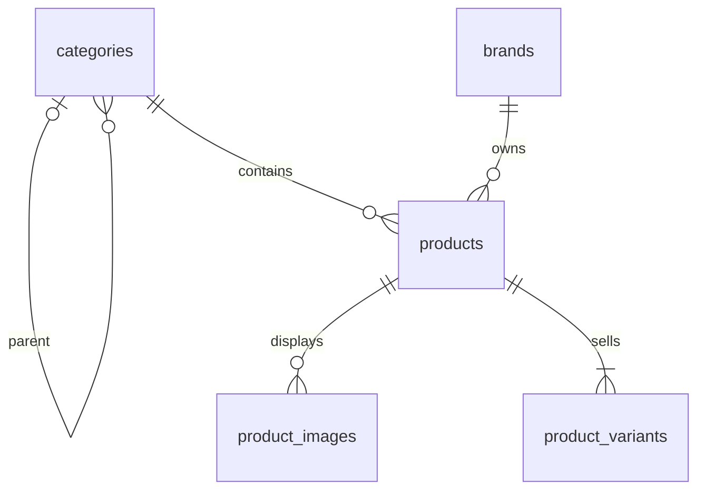
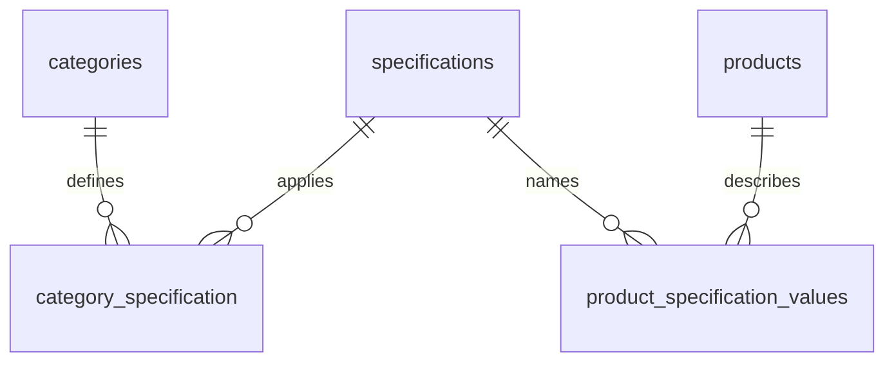
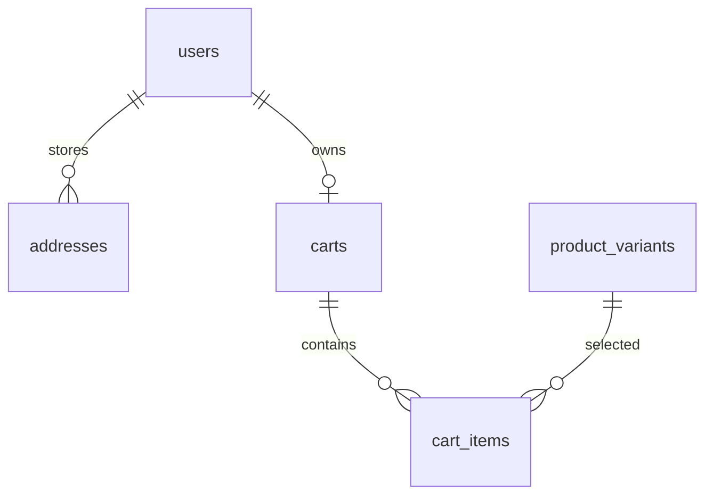
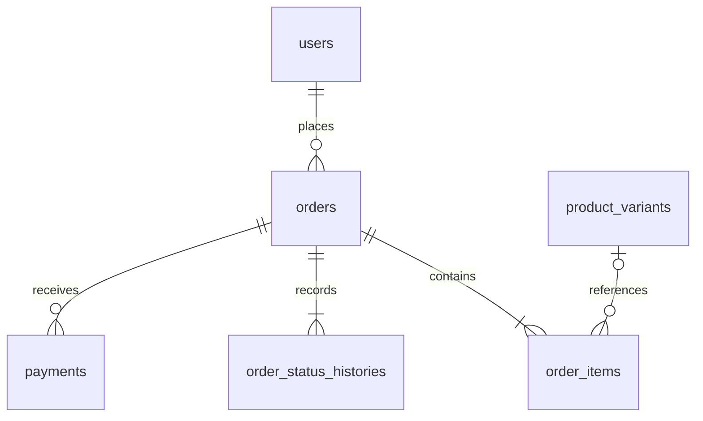

# ShopHub — Thiết kế database v1

Ngày: 05/11/2026  
Trạng thái: Thiết kế mục tiêu để triển khai; chưa phải các bảng đã có trên máy người dùng.

## 1. Phạm vi và quyết định

- Website một cửa hàng, vai trò admin/customer; không có nhà bán hàng độc lập.
- Công nghệ giữ theo StayHub: Laravel 12 REST API, Sanctum SPA session authentication, React/Vite/JSX, MySQL.
- Ba nhóm hàng khởi đầu: Laptop; Linh kiện và phụ kiện; Thiết bị gia dụng.
- Giao diện và cách tổ chức nội dung tham khảo VNAShop; đây là thiết kế riêng của ShopHub, không phải database nội bộ của VNAShop.
- Bản đầu: xem/tìm/lọc sản phẩm, tài khoản, địa chỉ, giỏ hàng, đặt COD, xử lý đơn và thống kê.
- Yêu cầu đăng nhập khi đặt hàng. Khách chưa đăng nhập vẫn duyệt sản phẩm.
- Lọc bản đầu theo danh mục, thương hiệu, khoảng giá; thông số trước hết phục vụ hiển thị.
- Mỗi sản phẩm thuộc một danh mục chính (ưu tiên danh mục lá), có một thương hiệu, nhiều ảnh và ít nhất một biến thể.
- Mỗi cấu hình phần cứng được tạo thành một sản phẩm riêng. Biến thể bản đầu phục vụ lựa chọn như màu sắc; các biến thể của một sản phẩm dùng chung bảng thông số. Nếu sau này cho cấu hình phần cứng khác nhau trong một sản phẩm, phải bổ sung thông số ở cấp biến thể.
- Sản phẩm không có lựa chọn dùng một biến thể mặc định.
- SKU, giá niêm yết, giá bán và tồn kho nằm ở product_variants.
- Khuyến mãi bản đầu thể hiện bằng giá niêm yết/giá bán; chưa có voucher hoặc lịch chiến dịch giảm giá.
- Banners triển khai sau chức năng sản phẩm và đơn hàng.

## 2. Quy ước dữ liệu

- PK: BIGINT UNSIGNED tự tăng; FK: cùng kiểu với PK được tham chiếu.
- Mọi bảng có id, created_at, updated_at, trừ pivot category_specification chỉ dùng khóa chính ghép và timestamps.
- NN = NOT NULL; NULL = có thể bỏ trống.
- Tiền VND dùng BIGINT UNSIGNED, không lưu chuỗi có dấu phân cách và không dùng float.
- Số lượng tồn và số lượng mua dùng INT UNSIGNED; số lượng mua bắt buộc >= 1.
- Dùng VARCHAR cho trạng thái và kiểm tra bằng validation/enum PHP; không phụ thuộc enum MySQL.
- Thời gian lưu thống nhất UTC, hiển thị theo Asia/Ho_Chi_Minh.
- Dùng utf8mb4. Các slug là chữ thường, dạng URL thân thiện.
- Tất cả file ảnh lưu đường dẫn tương đối; không lưu dữ liệu nhị phân ảnh trong bảng.
- Phân trang các danh sách. Backend quyết định quyền truy cập và giá cuối cùng.

## 3. ERD theo nhóm

### 3.1. Danh mục sản phẩm

Quan hệ "ít nhất một biến thể" được đảm bảo bằng nghiệp vụ tạo sản phẩm trong transaction, không chỉ bằng FK.

### 3.2. Thông số kỹ thuật

Một thông số chỉ được gán cho sản phẩm nếu đã cấu hình cho đúng danh mục của sản phẩm. Bản đầu không tự kế thừa thông số từ danh mục cha; khai báo rõ trên từng danh mục lá.

### 3.3. Người dùng và giỏ hàng

### 3.4. Đơn hàng

order_items và orders lưu snapshot để lịch sử không thay đổi khi sửa sản phẩm hoặc địa chỉ.
order_status_histories.changed_by có thể NULL cho sự kiện hệ thống; quan hệ tới users mô tả ở từ điển dữ liệu.
banners độc lập và có thể liên kết đến URL nội bộ qua link_url.

## 4. Từ điển dữ liệu

Các cột mặc định id/created_at/updated_at không lặp lại bên dưới.

### 4.1. users — mở rộng bảng Laravel hiện có

| Cột | Kiểu | Ràng buộc / mục đích |
|---|---|---|
| name | VARCHAR(255) | NN |
| email | VARCHAR(255) | NN, UNIQUE; chuẩn hóa trước khi lưu |
| email_verified_at | TIMESTAMP | NULL, giữ cấu trúc Laravel |
| password | VARCHAR(255) | NN, hash bằng Laravel |
| phone | VARCHAR(20) | NULL, không unique ở bản đầu |
| role | VARCHAR(20) | NN, mặc định customer; chỉ admin/customer |
| is_active | BOOLEAN | NN, mặc định true |
| remember_token | VARCHAR(100) | NULL, giữ cấu trúc Laravel |

Không tạo lại users. Viết migration bổ sung phone, role, is_active. Đăng ký công khai luôn gán customer ở backend; không nhận role từ payload. Tạo admin bằng seeder dùng mật khẩu local, không commit mật khẩu thật.

### 4.2. addresses

| Cột | Kiểu | Ràng buộc / mục đích |
|---|---|---|
| user_id | FK users | NN |
| recipient_name | VARCHAR(255) | NN |
| phone | VARCHAR(20) | NN |
| province | VARCHAR(100) | NN |
| ward | VARCHAR(100) | NN |
| address_line | VARCHAR(255) | NN, số nhà/đường/thông tin bổ sung |
| is_default | BOOLEAN | NN, mặc định false |

Địa chỉ dạng nhập text ở bản đầu, không khóa theo danh mục hành chính cũ; không bắt buộc cấp quận/huyện. INDEX(user_id). Đổi địa chỉ mặc định trong transaction, khóa user để đảm bảo tối đa một địa chỉ mặc định. Đây là quy tắc service, không phải bảo đảm chỉ bằng BOOLEAN.

### 4.3. categories

| Cột | Kiểu | Ràng buộc / mục đích |
|---|---|---|
| parent_id | FK categories | NULL cho danh mục gốc |
| name | VARCHAR(150) | NN |
| slug | VARCHAR(180) | NN, UNIQUE |
| image_path | VARCHAR(255) | NULL |
| sort_order | INT UNSIGNED | NN, mặc định 0 |
| is_active | BOOLEAN | NN, mặc định true |

INDEX(parent_id). Ngăn tự làm cha hoặc tạo vòng lặp. Chặn xóa danh mục đang có danh mục con/sản phẩm; dùng is_active khi muốn ẩn.

### 4.4. brands

| Cột | Kiểu | Ràng buộc / mục đích |
|---|---|---|
| name | VARCHAR(150) | NN, UNIQUE |
| slug | VARCHAR(180) | NN, UNIQUE |
| logo_path | VARCHAR(255) | NULL |
| is_active | BOOLEAN | NN, mặc định true |

Chặn xóa thương hiệu đang có sản phẩm.

### 4.5. products

| Cột | Kiểu | Ràng buộc / mục đích |
|---|---|---|
| category_id | FK categories | NN |
| brand_id | FK brands | NN |
| name | VARCHAR(255) | NN |
| slug | VARCHAR(255) | NN, UNIQUE |
| short_description | TEXT | NULL |
| description | LONGTEXT | NULL, kiểm soát HTML nếu hỗ trợ nội dung rich text |
| warranty_months | SMALLINT UNSIGNED | NN, mặc định 0 |
| status | VARCHAR(20) | NN, mặc định draft; draft/active/inactive |
| is_featured | BOOLEAN | NN, mặc định false |
| deleted_at | TIMESTAMP | NULL, soft delete |

INDEX(category_id, status), INDEX(brand_id, status). Trang public chỉ trả sản phẩm active, chưa soft delete, danh mục và thương hiệu đang hoạt động. Phải có biến thể active trước khi xuất bản. Trang danh mục cha lấy thêm sản phẩm thuộc các danh mục con đang hoạt động. Mỗi cấu hình laptop riêng có slug riêng.

### 4.6. product_images

| Cột | Kiểu | Ràng buộc / mục đích |
|---|---|---|
| product_id | FK products | NN |
| path | VARCHAR(255) | NN |
| alt_text | VARCHAR(255) | NULL |
| sort_order | INT UNSIGNED | NN, mặc định 0 |

INDEX(product_id, sort_order). Ảnh đầu theo sort_order rồi id là ảnh đại diện; bản đầu không thêm is_primary để tránh nhiều ảnh cùng được đánh dấu.

### 4.7. product_variants

| Cột | Kiểu | Ràng buộc / mục đích |
|---|---|---|
| product_id | FK products | NN |
| sku | VARCHAR(100) | NN, UNIQUE |
| name | VARCHAR(150) | NN, ví dụ Mặc định hoặc Đen |
| options | JSON | NULL, ví dụ {"color":"Đen"} |
| list_price | BIGINT UNSIGNED | NN, giá niêm yết |
| sale_price | BIGINT UNSIGNED | NN, giá khách thực trả |
| stock_quantity | INT UNSIGNED | NN, mặc định 0 |
| is_active | BOOLEAN | NN, mặc định true |

INDEX(product_id, is_active). Kiểm tra 0 < sale_price <= list_price. Hết hàng là stock_quantity = 0, không cần status riêng. Tỷ lệ giảm tính từ hai giá; không lưu thêm discount_percent. Thẻ sản phẩm hiển thị giá thấp nhất trong các biến thể active; dùng giá và tồn của biến thể được chọn khi mua. Không hard delete biến thể từng được bán; khóa bằng is_active.

### 4.8. specifications

| Cột | Kiểu | Ràng buộc / mục đích |
|---|---|---|
| name | VARCHAR(100) | NN, ví dụ RAM |
| code | VARCHAR(100) | NN, UNIQUE, ví dụ ram |
| unit | VARCHAR(30) | NULL, ví dụ GB |
| is_active | BOOLEAN | NN, mặc định true |

Dữ liệu thông số bản đầu dạng text để hiển thị, không hứa hẹn lọc số học trên cột text. RAM lưu 16 nếu unit=GB, không lưu lặp 16 GB. Thông số dạng chuỗi như CPU có unit=NULL.

### 4.9. category_specification — pivot

| Cột | Kiểu | Ràng buộc / mục đích |
|---|---|---|
| category_id | FK categories | NN |
| specification_id | FK specifications | NN |
| is_required | BOOLEAN | NN, mặc định false |
| sort_order | INT UNSIGNED | NN, mặc định 0 |

PRIMARY KEY(category_id, specification_id), có timestamps, không có id riêng. Khi xuất bản sản phẩm phải đủ các thông số required của danh mục.

### 4.10. product_specification_values

| Cột | Kiểu | Ràng buộc / mục đích |
|---|---|---|
| product_id | FK products | NN |
| specification_id | FK specifications | NN |
| value | TEXT | NN |

UNIQUE(product_id, specification_id). Backend kiểm tra thông số nằm trong cấu hình danh mục; FK riêng lẻ không tự đảm bảo quy tắc này. Nếu đổi danh mục sản phẩm, phải xác thực lại và xử lý thông số không còn phù hợp trong transaction.

### 4.11. carts

| Cột | Kiểu | Ràng buộc / mục đích |
|---|---|---|
| user_id | FK users | NN, UNIQUE |

Mỗi user có tối đa một giỏ lâu dài, giỏ có thể chưa tồn tại cho đến lần thêm đầu tiên. Không lưu tổng tiền vào carts.

### 4.12. cart_items

| Cột | Kiểu | Ràng buộc / mục đích |
|---|---|---|
| cart_id | FK carts | NN |
| product_variant_id | FK product_variants | NN |
| quantity | INT UNSIGNED | NN, >= 1 |

UNIQUE(cart_id, product_variant_id). Thêm cùng biến thể thì cộng số lượng. Giá giỏ đọc từ database; giỏ không giữ hàng và không khóa giá. Kiểm tra lại tình trạng bán, giá và tồn khi checkout.

### 4.13. orders

| Cột | Kiểu | Ràng buộc / mục đích |
|---|---|---|
| user_id | FK users | NN |
| order_code | VARCHAR(40) | NN, UNIQUE, mã ngẫu nhiên khó đoán |
| checkout_token | CHAR(36) | NN, UNIQUE, chống tạo đơn lặp |
| recipient_name | VARCHAR(255) | NN, snapshot |
| recipient_phone | VARCHAR(20) | NN, snapshot |
| shipping_province | VARCHAR(100) | NN, snapshot |
| shipping_ward | VARCHAR(100) | NN, snapshot |
| shipping_address_line | VARCHAR(255) | NN, snapshot |
| subtotal | BIGINT UNSIGNED | NN |
| shipping_fee | BIGINT UNSIGNED | NN, mặc định 0 |
| discount_total | BIGINT UNSIGNED | NN, mặc định 0 ở bản đầu |
| grand_total | BIGINT UNSIGNED | NN |
| payment_method | VARCHAR(30) | NN, cod ở bản đầu |
| payment_status | VARCHAR(30) | NN, unpaid/paid; mặc định unpaid |
| status | VARCHAR(30) | NN, pending/confirmed/shipping/completed/cancelled |
| note | TEXT | NULL, lời nhắn khách |
| cancellation_reason | TEXT | NULL |
| cancelled_at | TIMESTAMP | NULL |
| completed_at | TIMESTAMP | NULL |

INDEX(user_id, created_at), INDEX(status, created_at), INDEX(payment_status).
grand_total = subtotal + shipping_fee - discount_total, luôn không âm.
Backend tạo mã đơn và lưu snapshot từ địa chỉ thuộc chính user. Không dùng address_id làm nguồn hiển thị duy nhất.
checkout_token do frontend tạo cho một lần đặt, giữ nguyên khi retry; backend ràng buộc payload/user và kiểm tra lại quyền sở hữu khi trả đơn đã có.
Các thay đổi nội dung giỏ cần token mới. Nếu token cũ có payload khác thì từ chối; không âm thầm trả kết quả không khớp.
Bản đầu chỉ checkout toàn bộ giỏ; địa chỉ và phí vận chuyển được backend xác thực lại.
Phí vận chuyển mặc định 0 cho demo, hiển thị rõ; có thể thay bằng cấu hình phí cố định ở backend sau.

### 4.14. order_items

| Cột | Kiểu | Ràng buộc / mục đích |
|---|---|---|
| order_id | FK orders | NN |
| product_variant_id | FK product_variants | NULL để lưu lịch sử độc lập |
| product_name | VARCHAR(255) | NN, snapshot |
| variant_name | VARCHAR(150) | NN, snapshot |
| sku | VARCHAR(100) | NN, snapshot |
| image_path | VARCHAR(255) | NULL, snapshot đường dẫn |
| unit_price | BIGINT UNSIGNED | NN, giá bán lúc mua |
| quantity | INT UNSIGNED | NN, >= 1 |
| line_total | BIGINT UNSIGNED | NN, unit_price * quantity |

INDEX(order_id). Không ghi đè lịch sử khi sửa giá/tên sản phẩm.
Snapshot đường dẫn ảnh không đảm bảo ảnh còn tồn tại; nếu xóa asset phải có ảnh thay thế.
Một đơn phải có ít nhất một item; đảm bảo bằng service/transaction.

### 4.15. order_status_histories

| Cột | Kiểu | Ràng buộc / mục đích |
|---|---|---|
| order_id | FK orders | NN |
| changed_by | FK users | NULL khi hệ thống xử lý |
| from_status | VARCHAR(30) | NULL cho lần tạo |
| to_status | VARCHAR(30) | NN |
| note | TEXT | NULL |

INDEX(order_id, created_at). Lần tạo đơn ghi NULL -> pending. Mọi thay đổi trạng thái ghi lịch sử trong cùng transaction; không cho sửa lịch sử qua CRUD thông thường.

### 4.16. payments

| Cột | Kiểu | Ràng buộc / mục đích |
|---|---|---|
| order_id | FK orders | NN |
| method | VARCHAR(30) | NN, cod |
| amount | BIGINT UNSIGNED | NN, bằng grand_total cho COD bản đầu |
| status | VARCHAR(30) | NN, pending/succeeded/cancelled |
| transaction_code | VARCHAR(150) | NULL, UNIQUE |
| paid_at | TIMESTAMP | NULL |

INDEX(order_id, status).
Thiết kế order 1:N payments để có thể mở rộng; bản COD đầu chỉ tạo một payment cho mỗi order trong transaction tạo đơn.
Khi hoàn tất giao COD, cập nhật payment sang succeeded và orders.payment_status sang paid trong cùng transaction.
Chuyển đơn shipping -> completed đồng thời xác nhận đã thu COD trong bản demo; giao diện Admin phải nêu rõ hành động.
Đơn cancelled có payment cancelled và payment_status vẫn unpaid. Chưa triển khai thanh toán từng phần/hoàn tiền.

### 4.17. banners

| Cột | Kiểu | Ràng buộc / mục đích |
|---|---|---|
| title | VARCHAR(255) | NN |
| image_path | VARCHAR(255) | NN |
| link_url | VARCHAR(255) | NULL, URL nội bộ hợp lệ |
| position | VARCHAR(50) | NN, ví dụ home_hero |
| sort_order | INT UNSIGNED | NN, mặc định 0 |
| is_active | BOOLEAN | NN, mặc định true |
| starts_at | TIMESTAMP | NULL |
| ends_at | TIMESTAMP | NULL |

INDEX(position, is_active). Kiểm tra ends_at > starts_at nếu có cả hai. Banner công khai phải active và trong khoảng thời gian áp dụng.

## 5. Chính sách xóa và tính toàn vẹn

| Quan hệ | Hành vi dự kiến |
|---|---|
| categories.parent_id | RESTRICT khi còn danh mục con |
| products.category_id, products.brand_id | RESTRICT; ưu tiên ẩn dữ liệu |
| product_images.product_id, product_variants.product_id | CASCADE chỉ cho hard delete sản phẩm chưa bán; bình thường soft delete |
| category_specification và product_specification_values | CASCADE theo danh mục/thông số/sản phẩm khi cho phép xóa; service chặn xóa thông số đang sử dụng |
| addresses.user_id, carts.user_id | CASCADE nếu thực sự xóa user chưa có đơn |
| cart_items.cart_id, cart_items.product_variant_id | CASCADE |
| orders.user_id | RESTRICT; khóa tài khoản khi user đã có đơn |
| order_items.order_id, histories.order_id, payments.order_id | RESTRICT; không cung cấp thao tác xóa đơn lịch sử |
| order_items.product_variant_id | SET NULL làm lớp dự phòng; nghiệp vụ vẫn chặn hard delete biến thể đã bán |
| histories.changed_by | SET NULL |

FK không thay thế authorization, validation hoặc kiểm soát transaction.
Soft delete products không chạy CASCADE, các biến thể vẫn cần được lọc theo tình trạng sản phẩm khi bán.

## 6. Quy tắc đặt hàng và tồn kho

1. Xác thực user đang hoạt động và địa chỉ thuộc user.
2. Khóa giỏ của user trong transaction; mọi thao tác sửa giỏ cũng dùng cùng quy ước khóa.
3. Nếu checkout_token đã tồn tại, xác nhận đúng user và cùng payload rồi trả đơn cũ; xung đột UNIQUE được xử lý bằng đọc lại an toàn, không tạo thêm đơn.
4. Đọc cart_items, khóa các product_variants theo thứ tự id tăng dần bằng khóa ghi trong transaction.
5. Kiểm tra sản phẩm/danh mục/thương hiệu/biến thể được bán, số lượng hợp lệ và tồn đủ. Các luồng admin điều chỉnh tồn cũng phải đồng bộ bằng khóa hoặc cập nhật nguyên tử.
6. Đọc lại giá từ database. Nếu giá khác giá khách vừa xác nhận, yêu cầu khách xác nhận lại trước khi tạo đơn; không tin giá client làm giá cuối cùng.
7. Backend tính subtotal, shipping_fee, grand_total.
8. Tạo orders, order_items snapshot, payment COD pending và lịch sử pending.
9. Trừ tồn đúng một lần; xóa các dòng giỏ đã đặt.
10. Commit tất cả hoặc rollback tất cả nếu lỗi. Không gửi email/dịch vụ ngoài trước commit.

Không trừ tồn khi thêm giỏ. Bản đầu trừ tồn khi tạo đơn thành công.
Không thêm inventory_movements ở v1; mọi điều chỉnh tồn đi qua service. Khi cần nhật ký kho đầy đủ sẽ bổ sung bảng này.

## 7. Trạng thái đơn và quyền

| Từ | Sang | Ai được phép / điều kiện |
|---|---|---|
| Chưa có | pending | Customer đặt thành công |
| pending | confirmed | Admin |
| pending | cancelled | Chủ đơn hoặc Admin, chưa thu tiền |
| confirmed | shipping | Admin |
| confirmed | cancelled | Admin, chưa thu tiền |
| shipping | completed | Admin, xác nhận đã thu COD |
| completed | Bất kỳ trạng thái khác | Không hỗ trợ ở v1 |
| cancelled | Bất kỳ trạng thái khác | Không hỗ trợ ở v1 |

Hủy đơn phải khóa order, kiểm tra trạng thái trước khi hoàn tồn và chuyển cancelled trong cùng transaction. Hai yêu cầu hủy đồng thời chỉ hoàn tồn một lần. Khóa biến thể theo thứ tự id như checkout để giảm deadlock.
Đổi trạng thái chỉ theo bảng trên. Không nhận tùy ý trường status từ endpoint cập nhật chung.
API đơn hàng luôn kiểm tra owner/admin; biết mã đơn không đủ quyền đọc địa chỉ và thông tin cá nhân.

## 8. Thống kê v1

- Doanh thu: tổng grand_total của đơn completed và paid theo completed_at.
- Giá trị hàng bán: tổng subtotal - discount_total trên cùng tập đơn; trình bày riêng nếu cần.
- Không tính đơn pending, confirmed, shipping hoặc cancelled vào doanh thu.
- Sản phẩm bán chạy: tổng quantity của order_items thuộc đơn completed và paid.
- Nhóm theo sản phẩm bằng biến thể khi còn liên kết; giữ SKU snapshot để không mất dòng lịch sử.
- Số đơn mới và số đơn hủy là chỉ số riêng.
- Truy vấn khoảng thời gian theo múi giờ hiển thị rồi quy đổi về UTC; không dựa vào giờ máy client.

## 9. Thứ tự migration và triển khai

Giữ các bảng Laravel hiện có users, sessions, cache, jobs, personal_access_tokens và bảng hạ tầng đi kèm. Không dùng migrate:fresh để khởi tạo thêm nghiệp vụ.

| Đợt | Bảng | Tiêu chí hoàn thành |
|---|---|---|
| 1 | categories, brands, products, product_variants, product_images | FK đúng; seed và đọc được sản phẩm với thương hiệu, danh mục, biến thể |
| 2 | specifications, category_specification, product_specification_values | Bảng thông số hiển thị đúng cho ba nhóm hàng |
| 3 | Bổ sung users; addresses | Auth, role, tài khoản khóa và ownership được kiểm soát |
| 4 | carts, cart_items | Thêm/cộng/sửa/xóa, một dòng mỗi biến thể |
| 5 | orders, order_items, order_status_histories, payments | COD, transaction, tồn kho, retry và hủy đơn hoạt động |
| 6 | banners | Có nội dung trang chủ quản trị được |

Thứ tự tạo trong đợt 1: categories -> brands -> products -> product_variants -> product_images.
Thứ tự rollback là ngược lại.
Trước khi triển khai API Admin, hoàn thành auth và authorization; tạo model và seed chưa đồng nghĩa mở API công khai.

## 10. Dữ liệu mẫu

- Danh mục: Laptop; Linh kiện và phụ kiện; Thiết bị gia dụng.
- Thương hiệu mẫu: ASUS, MSI, Kingston, Logitech, Philips (chỉ là dữ liệu demo).
- Một laptop cấu hình cố định với hai màu, SKU và tồn riêng.
- Một SSD 1 TB với một biến thể mặc định.
- Một bình đun với một biến thể mặc định.
- Có một biến thể hết hàng để kiểm tra trạng thái.
- Giá, tồn, thời hạn bảo hành là số liệu giả lập; không khẳng định là thông tin bán hàng thực tế.
- Seeder chạy lặp không nhân bản danh mục/thương hiệu/SKU, và không đặt lại tồn thực tế ở môi trường production.

## 11. Các kiểm tra quan trọng khi lập trình

- SKU, slug trùng phải bị từ chối.
- Không xuất bản sản phẩm thiếu biến thể/thông số bắt buộc.
- Giá 0, giá âm, sale_price > list_price, quantity=0 bị từ chối.
- Customer không vào API Admin; user khóa không được tiếp tục thao tác có xác thực.
- Không đọc/sửa địa chỉ, giỏ, đơn của user khác.
- Hai khách mua đơn vị cuối cùng: tối đa một đơn thành công, tồn không âm.
- Gửi lại checkout_token: chỉ một đơn và một lần trừ tồn.
- Hủy lặp hoặc hủy đồng thời: chỉ một lần hoàn tồn.
- Sửa giá/tên/địa chỉ sau mua: lịch sử đơn không đổi.
- Xóa mềm sản phẩm: không mua tiếp được nhưng đơn cũ vẫn xem được.
- Đơn hoàn tất chỉ được ghi nhận doanh thu khi đã paid.

## 12. Cách đưa tài liệu vào project trên Windows

1. Trong GitHub Desktop, chuyển sang nhánh dev đã publish.
2. Trong VS Code tạo thư mục docs tại gốc laravel-react-shophub.
3. Đặt file này tại docs/shophub-database-design.md.
4. Mở file và nhấn Ctrl+Shift+V để xem Markdown (sơ đồ Mermaid cần trình xem hỗ trợ Mermaid).
5. GitHub Desktop: xem Changes, commit với nội dung docs: add ShopHub database design.
6. Nhấn Push origin (hoặc Publish branch nếu dev chưa publish).

Tài liệu này không chỉnh database trên máy bạn. Bước lập trình tiếp theo là viết migration/model cho đợt 1, chạy migrate, nạp seeder và kiểm tra quan hệ.

